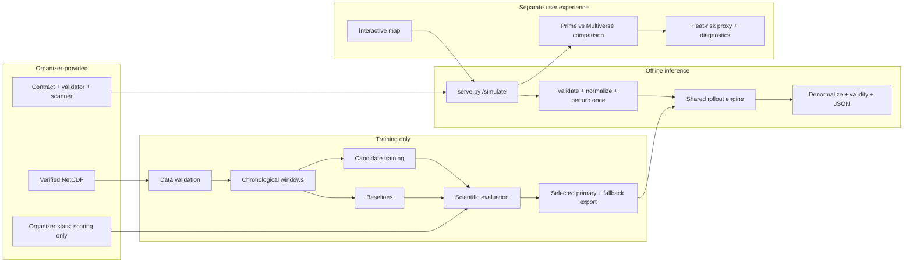
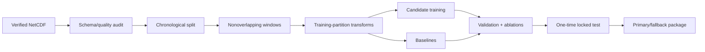
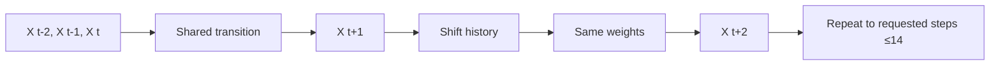
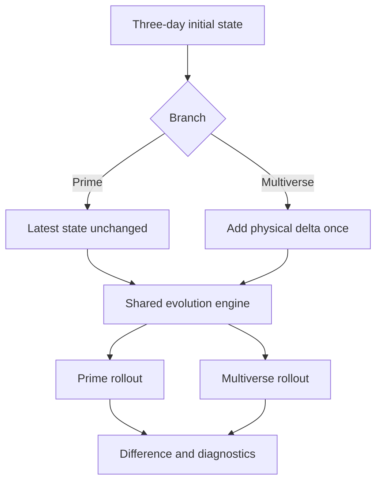
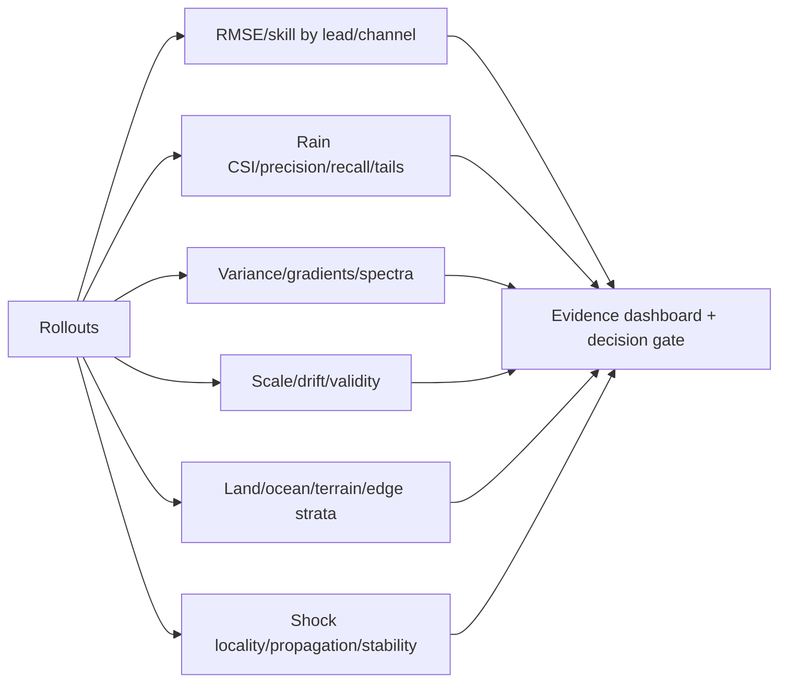
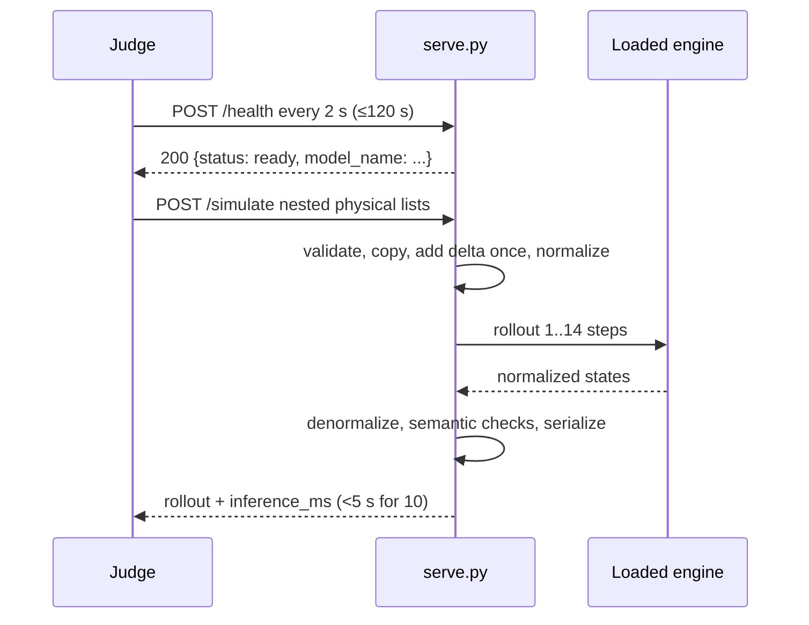
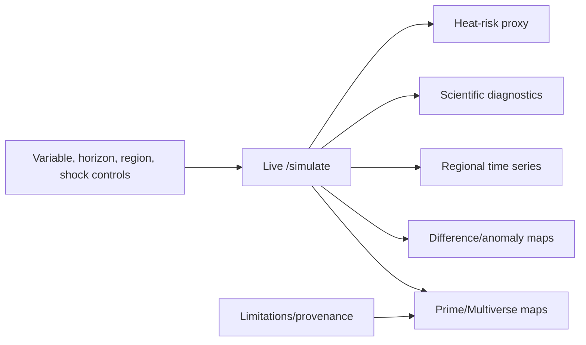
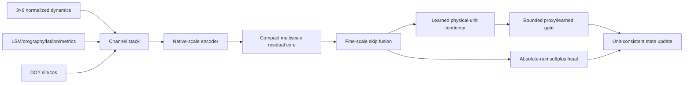
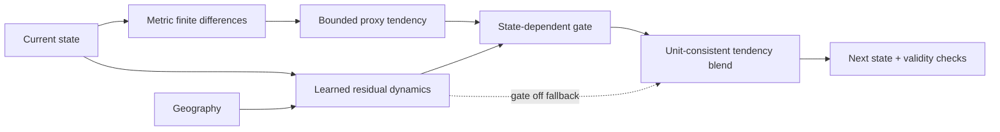
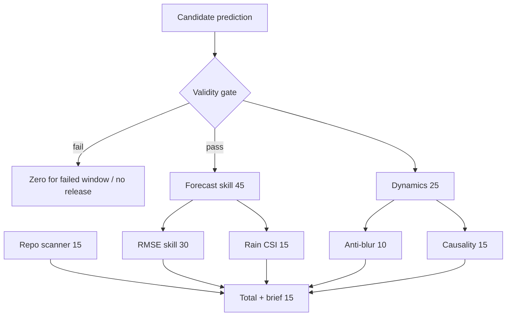

# Product Requirements Document
## Multiverse of Monsoon — Physics-Aware Regional Atmospheric Digital Twin

## 1. Document metadata and version history

| Field | Value |
|---|---|
| Version | 1.2 — implementation-controlled team edition |
| Date | 2026-11-26 |
| Status | **ACTIVE IMPLEMENTATION — P0 foundation on `feat/p0-foundation`** |
| Scope | Requirements, architecture, implementation control, testing, evidence, and compliance |
| Implementation authorization | **Granted by team direction on 2026-11-26; P0 first, P1 only behind gates** |
| Official kit | `v1.0.0`, commit `689c8798bbff7f318a1e74878a6985abc646080a` |
| Primary authorship mode | Team-directed engineering plan; no experimental results claimed |

Change control: material changes to channel order, units, perturbation semantics, split, primary/fallback architecture, evaluation definitions, or compliance interpretation require an ADR and team approval.

This file is the single shareable engineering blueprint and the authoritative implementation contract in the submission repository. It contains the requirements, evidence, architecture, experiments, tests, roadmap, risks, compliance gates, decisions, and implementation ledger needed by the team. Code may refine internal mechanics only when it preserves these interfaces and records the change here or in a linked ADR.

## 2. Executive summary

Build a CPU-efficient regional atmospheric state-transition system that maps three daily Indian-domain states to up to 14 future daily states and uses the same learned transition after an optional one-time physical-unit perturbation. The official score rewards forecast skill, heavy rain, retained spatial variance, and localized stable shock propagation under a 5-second ten-step limit.

The measured dataset is small-grid but substantial in time: 6,209 continuous days, six dynamic fields on 32×36 cells, plus fractional land-sea mask and orography. It has high one-day persistence, strong annual/geographical structure, and unusually difficult precipitation tails. It lacks vertical profiles, lateral boundary forcing, radiation/cloud/soil/ocean state, and counterfactual labels. The product is therefore an empirical regional atmospheric digital twin, not a complete numerical weather model.

**USP.** GRAST is not a conventional image-to-image weather predictor. It combines metric-aware regional geography, a shared perturbation-capable transition, multi-step stability training, and—subject to ablation—a bounded state-dependent gate that can admit an approximate transport tendency where it helps and defer to learned dynamics where the proxy is unreliable. Existing residual CNN, advection, gating, and rollout-training techniques are established; our proposed contribution is their compute-bounded, open-boundary adaptation to this six-field regional state, validated through forecast, drift, extreme-rain, and unfamiliar-perturbation tests.

Proposed strategy:

1. Establish persistence, permitted seasonal climatology, and regularized linear baselines.
2. Build GRAST: a compact shared-weight residual CNN with nonperiodic multiscale spatial processing, static/coordinate conditioning, supplied seasonal phase, and a separately ablated gated transport pathway.
3. Train progressively on autoregressive rollouts, starting with a simple normalized robust loss.
4. Introduce at most one extreme/sharpness loss at a time after measured diagnosis.
5. Test one primary innovation—the bounded geography-aware transport/residual gate—against additive and learned-only formulations; abandon it if it does not improve skill, drift, or perturbation behavior within budget.
6. Maintain an independently trained simpler residual CNN fallback.

Primary candidate, fallback, novelty hypotheses, resource targets, and split all require approval. Nothing here is experimentally validated.

## 3. Project vision

Create a scientifically honest prototype that forecasts plausible regional atmospheric evolution and lets reviewers inspect how unfamiliar localized changes affect the same learned dynamics. Optimize for reproducible evidence, generalization, stability, and compliance—not architectural fashion or scripted demonstrations.

## 4. Exact problem statement

**VERIFIED OFFICIAL REQUIREMENT.** Given `init_states[3,6,32,36]`, supplied last-day `doy_sincos`, `steps`, and a nullable physical delta `perturbation[6,32,36]`, return `rollout[steps,6,32,36]` in physical units. Timeline Prime uses the unmodified latest state. Multiverse adds the delta once to the latest state and uses the same engine. The scored path is ten days; contract code supports at most 14. See problem statement pages 7–10 and official contract lines 5–53.

## 5. Stakeholders and intended users

- Automated evaluator: contract-valid, fast, deterministic outputs.
- Hackathon technical judges: scientific reasoning, original work, live new-shock response, limitations.
- Team researchers/engineers: reproducible experiments and modular interfaces.
- Demonstration users: compare base and perturbed trajectories and qualified impact proxies.
- Future researchers: extend data/state/boundaries without rewriting the core evaluation framework.

## 6. Goals and non-goals

### Goals

- Beat persistence at day 4 and improve over the stronger persistence/climatology reference.
- Stable finite 10–14-day autoregression with nonnegative precipitation and retained structure.
- Continuous, bounded, localized response to arbitrary valid perturbations; exact zero consistency.
- Strong heavy-rain and tail diagnostics without indiscriminate rain inflation.
- CPU-only offline inference with margin under official limits.
- Live dashboard/impact output derived from submitted engine.
- Complete provenance, tests, fallback, and honest claim boundaries.

### Non-goals

- Full primitive-equation/Navier–Stokes or coupled climate simulation.
- Operational warnings or official heatwave declarations.
- Counterfactual causal truth without intervention data.
- External forecast APIs/data/checkpoints at inference.
- Global model reproduction, distributed microservices, LLM/chatbot features, or scenario scripts.

## 7. Source inventory

The consolidated inventory and hashes are included in Appendix F. The only unresolved organizer artifact is the Canva presentation export. PDF, release, code, contract, validator, scoring, scanner, dataset, statistics, and license were inspected.

## 8. Verified organizer constraints

The consolidated mandatory-requirement matrix is included in Appendix G. Official limits: 4 CPU cores, 6 GB RAM, no GPU, offline/read-only repository, `/tmp` writes only, readiness ≤120 s, ten steps <5 s wall time, response <80 MB, root `serve.py`, weights local, repository/weights under stated 2 GB, and original work. Canonical wire format is finite nested JSON lists in physical units.

## 9. Requirements traceability

The traceability matrix assigns `FR`, `API`, `DATA`, `NFR`, `SCI`, `EVAL`, and `COMP` identifiers, sources, mandatory status, acceptance tests, and consequences. No mandatory item is accepted solely by documentation; implementation evidence must populate the matrix later.

## 10. Dataset analysis

The complete decision-relevant audit is consolidated in this section and Appendix H. Critical observations:

- Shape `[6209,6,32,36]`, 2005-01-01–2021-12-31, no time gaps/duplicates/NaN/Inf.
- Ascending 1° coordinates; longitudinal physical width shrinks about 110.5→88.2 km south→north.
- Lag-1 correlation: temperature .997, precipitation .712, winds .936/.907, pressure .947, water vapour .985.
- Precipitation median .551, P99 35.70, max 249.77 mm/day; 7.81% exact zeros.
- Fractional coastline and terrain from approximately sea level to 5,284 m.
- Strong seasonal and land/ocean contrasts; supplied mean/std reproduce full-data statistics.

Architectural consequence: local spatial processing and residual forecasting are plausible; precipitation needs separate evaluation; metric/edge/geography information matters; random splits would leak highly correlated windows.

## 11. Scientific background

Weather state evolution may be represented abstractly as `X_{t+1}=F(X_{t-h+1:t}, G, S_t)+ε`, with dynamic history `X`, geography `G`, seasonal phase `S`, unresolved forcing, and model error `ε`. A data-driven transition approximates conditional evolution in the training distribution. Autoregression repeatedly evaluates the transition on its own predictions, causing distribution shift and compounding error.

Hybrid weather literature shows value in tendency prediction, multi-step training, and explicit dynamics, but global systems use vertical state and forcing absent here. Compatibility judgments are included in sections 13–14.

## 12. Atmospheric modelling assumptions

| Statement | Category | Boundary |
|---|---|---|
| Daily fields contain predictive local/spatial structure | Experimental hypothesis supported by correlations | Must be validated chronologically |
| `u10/v10` provide directional proxy information | Physically motivated approximation | Not column wind |
| `tcwv` can be transported approximately | Approximation | Sources/sinks/boundary exchange prevent conservation |
| Coordinates/terrain/mask condition local dynamics | Engineering hypothesis | Association does not prove causation |
| Supplied seasonal phase aids generalization | Contract-permitted hypothesis | No dates/month lookup |
| Region has open boundaries | Established limitation | No exact closed-domain balance |

## 13. Research literature review

- GraphCast: multiscale graph global model; relational ideas only.
- NeuralGCM: differentiable core plus learned physics; tendency and rollout curriculum inspiration only.
- Pangu-Weather: global 3D transformer and hierarchical lead models; direct adoption unsuitable.
- FourCastNet/FNO: efficient long-range spectral processing; periodic/global bias risky here.
- ConvLSTM: local recurrent sequence model; viable challenger but potentially slower and harder to stabilize.
- WeatherBench 2: lead-wise, latitude-weighted, baseline-relative evaluation principles.

No external checkpoint or weather dataset is proposed.

## 14. Open-source compatibility matrix

The organizer kit is directly reusable as contract/test tooling; WeatherBench ideas are adaptable; ConvLSTM/FNO methods are adaptable only as experiments; GraphCast/NeuralGCM/FourCastNet/Pangu full systems are research inspiration or unsuitable. All adopted code requires a pinned version, license entry, and attribution.

## 15. Architecture alternatives

| Candidate | Parameters (estimate) | CPU/complexity | Strength | Primary risk |
|---|---:|---|---|---|
| Persistence/climatology/ridge | 0–small | Minimal | Essential references, robust | Cannot model nonlinear shocks well |
| Simple residual CNN | 0.3–2M | Very low | Strong locality, stable fallback | Limited receptive field |
| Geography-aware multiscale residual CNN | 1–5M | Low | Best balance; static/metric context | Padding/boundary and blur |
| Proxy-physics + learned residual | 1–5M + fixed ops | Low–medium | Directional interpretability | Wrong physics from incomplete state |
| ConvLSTM | 1–8M | Medium | Recurrent memory | Sequential latency/training complexity |
| Small FNO/multiscale operator | 1–8M | Low–medium | Long-range coupling | Artificial periodicity/small grid |
| Transformer/GNN/global models | large | High | Expressivity | Unjustified scale/data/compute |

## 16. Architecture decision matrix

The weighted matrix below gives the proposed geo-residual CNN 425/500, residual CNN 410, physics-guided 395, ConvLSTM 335, small FNO 325, and baselines 300. These are design estimates, not measurements.

## 17. Recommended architecture

### Minimum viable system

Persistence/climatology/ridge evaluation; compact residual CNN; shared autoregressive path; internal normalization; exact API; official validator/scanner; independently trained fallback; minimal live comparison dashboard.

### Primary candidate: GRAST (working name)

**Geography-aware Residual Atmospheric State Transition**:

- Input: three normalized dynamic states (18 channels), continuous LSM, normalized orography, latitude, longitude, `cos(lat)`/metric features, and broadcast supplied `doy_sincos`.
- Encoder: shallow nonperiodic convolutions.
- Core: compact residual blocks at native and one coarser scale; skip fusion preserves fine structure. A proposed bounded gate blends dimensionally matched learned and proxy tendencies; the learned-only gate-off path remains fully functional.
- Output: unit-converted physical one-day tendencies for five state channels plus a nonnegative absolute-precipitation head. The initial precipitation parameterization is `softplus`; occurrence/intensity separation is conditional on measured false-drizzle, heavy-rain, and false-positive failures.
- Rollout: same transition and weights each day; seasonal pair advanced analytically.
- No shock-specific inputs beyond the perturbed state.

### Fallback

A smaller single-scale residual CNN using dynamics + static fields and the same rollout/API. It must be trained and validated, not generated after failure.

### Optional extensions

One rain-tail/occurrence mechanism or one gradient loss may be tested only after diagnosis. Ensembles/OOD indicators and alternative backbones are post-core options. No additional innovation enters the submission without a measurable benefit and a passed latency/stability gate.

## 18. Complete system architecture



## 19. Mathematical formulation

Let `X_t∈R^{6×32×36}`, static `G`, seasonal pair `s_t`, and leakage-free training-partition normalization `N_c(x)=(x-μ_c^train)/σ_c^train`. Perturb once:

`X'_t = X_t + δ`, with `δ=0` for Timeline Prime/null.

History `H_t=[N(X_{t-2}),N(X_{t-1}),N(X'_t),G,s_t]`. The learned physical-unit tendency is `T^L_θ(H_t)` with units `U_c s⁻¹` for channel unit `U_c`. For candidate transported fields, define proxy tendency

`T^P_c = -(u_p ∂X_c/∂x + v_p ∂X_c/∂y) + κ_c∇²X_c`,

where `x,y` are metres, `u_p,v_p` are m s⁻¹ proxies, and `κ_c` is m² s⁻¹, so both terms have units `U_c s⁻¹`. A bounded state-dependent gate

`g_c(H_t,G)=g_max,c sigmoid(a_c(H_t,G))`, with `0≤g_max,c≤1`,

forms the proposed primary innovation:

`T_c = g_c T^P_c + (1-g_c)T^L_c`, `X_{t+1,c}=X'_{t,c}+Δt T_c`, with `Δt=86,400 s`.

Both branches are dimensionally identical before blending. The additive challenger is `T_c=T^L_c+λ_cT^P_c` with bounded dimensionless `λ_c`; learned-only is `g=0`/`λ=0`. Because a daily explicit advection step can have Courant number `|u|Δt/dx≫1`, the proxy must use stable substepping or a validated semi-Lagrangian discretization, with metric `dx(lat)`, `dy`, no longitudinal wrap, and an explicit open-boundary policy. Boundary backtraces leaving the domain cannot invent upstream weather: use zero proxy contribution/gate suppression there and let the learned closure dominate. Ten-metre wind is not column transport, precipitation is a daily accumulation rather than an advected state, and regional sources/sinks are unresolved; therefore proxy transport is initially limited to scientifically defensible candidate fields and may be rejected entirely.

For later steps, roll history forward and compute `s_{t+k}` analytically. The same transition is used in both universes. Mandatory output mapping is `tp=softplus(r_tp)` for nonnegativity and `t2m=233.15+100 sigmoid(r_T)` for contract compliance; all transformations retain physical units after inverse normalization. Other outputs use finite physical-unit reconstruction with no training-range clipping. Any nonfinite intermediate is a release-blocking failure, never silently replaced.

## 20. Detailed module specifications

| Module | Inputs → outputs | Responsibility / errors | Budget / tests | Priority |
|---|---|---|---|---|
| DatasetReader | NetCDF → typed arrays/coords | Verify hash/schema/order/units; fail closed | Training only; audit tests | P0 |
| WindowIndex | dates/split/horizon → indices | No cross-split overlap | Exact temporal sentinels | P0 |
| Transform | physical arrays ↔ normalized | Single source of means/scales; finite checks | <2 ms target; round trip | P0 |
| GeoFeatures | coords/static → fixed channels | LSM/orography/metric features | Bundled small tensors | P1 |
| Baselines | history/DOY → rollout | Persistence/climatology/ridge references | Metric parity | P0 |
| Transition | history/features → tendency | Shared one-day dynamics | ≤5M target; shape/determinism | P0/P1 |
| ProxyOperator | state/metrics → proxy tendencies | Optional finite differences, nonperiodic, bounded gate-off fallback | <10% latency overhead; three-hour experiment cap | P1 |
| RolloutEngine | history/steps/δ → future states | Apply δ once; advance phase; shared recurrence | 1–14 steps; stability tests | P0 |
| Diagnostics | truth/base/shock → metrics | Skill, rain, blur, shock, strata | Exact official parity | P0 |
| ExportLoader | artifact → initialized model | Hash/version/load once | cold-start/RAM | P0 |
| APIAdapter | JSON ↔ arrays | Contract, timing, errors, serialization | official validator | P0 |
| DashboardClient | user controls ↔ API | Live visualization only | provenance/integration | P0 demo |
| HeatRiskProxy | rollout/climatology → zones | Qualified anomaly/persistence proxy | scientific review | P0 demo |

Public interfaces and errors must be frozen before parallel implementation. Malformed requests should return deterministic 4xx without exposing internals; the official starter behavior is the baseline where the contract is silent.

### 20.1 Repository architecture and implementation ledger

The repository uses a thin-root, package-first architecture. Judge-facing serving imports only NumPy/FastAPI/Uvicorn and the inference package; xarray, NetCDF, and PyTorch remain training/model dependencies and must not leak into the persistence fallback or request codec. The organizer kit and dataset remain external references and are never copied into the submission history.

| PRD responsibility | Repository implementation | State / evidence |
|---|---|---|
| Frozen API entry point | `serve.py` | Implemented; binds `0.0.0.0`, loads one engine, deterministic 4xx |
| Contract and physical gates | `src/deadlock_monsoon/contract.py` | Implemented; lists/b64, shapes, finite values, steps 1–14, rain and temperature gates |
| Scenario-agnostic engine seam | `src/deadlock_monsoon/engine.py` | Implemented; `ForecastEngine` protocol and clearly labelled persistence fallback |
| Request orchestration | `src/deadlock_monsoon/service.py` | Implemented; copy/decode/perturb-once/engine/validate path |
| Verified NetCDF ingestion | `src/deadlock_monsoon/dataset.py` | Implemented; official SHA-256, dimensions, coordinates, order, units, finiteness |
| Chronological isolation and transforms | `src/deadlock_monsoon/data.py` | Implemented; continuous daily dates, split-local windows, training-only mean/scale |
| Baseline references | `src/deadlock_monsoon/baselines.py` | Implemented; persistence and training-only calendar-day climatology |
| Official-parity core metrics | `src/deadlock_monsoon/metrics.py` | Implemented; latitude RMSE, heavy-rain contingency metrics, variance ratio |
| Reproducible baseline evidence | `scripts/evaluate_baselines.py`, `reports/baselines/validation.json` | Implemented; 720 validation windows, days 1/4/8/10, verified dataset hash and split metadata |
| Learned-only GRAST control | `src/deadlock_monsoon/model.py` | Implemented as untrained seam; nonperiodic multiscale residual core, 265,062 parameters |
| Semantic physical outputs | `SemanticOutputMapper` in `model.py` | Implemented; absolute `softplus` rain, bounded absolute temperature, physical residual channels |
| Shared multi-step recursion | `src/deadlock_monsoon/torch_rollout.py` | Implemented as differentiable seam; same weights, perturb once, history shift, seasonal advance |
| Rollout-aware objective | `src/deadlock_monsoon/training.py` | Implemented; normalized channel-balanced Huber, explicit uniform/mild lead weights, logged 2→4→8→10 curriculum |
| Artifact provenance and loading | `src/deadlock_monsoon/checkpoint.py` | Implemented; state-dict-only primary/fallback bundles, config/split/train-stat provenance, SHA-256 verification, CPU load |
| Real-data training windows | `src/deadlock_monsoon/train_data.py` | Implemented; physical history/targets, static normalization, exact target alignment, last-input-day seasonal pair |
| Training prototype | `scripts/prototype_train.py` | Implemented and executed on 64 verified training windows, two self-fed leads, seed 7, 10 epochs; evidence is explicitly non-release |
| Prototype evidence | `reports/training/prototype_seed7.json` | Real-data loss ratio 0.669; finite output, rain minimum 0.499 mm/day, temperature 252.60–308.84 K; 22,630-parameter smoke model |
| Automated verification | `tests/` | 41 tests passing at v1.2 ledger update; official schema validator passed all list/b64 scenarios |
| Runtime/training dependency separation | `pyproject.toml` | Implemented; minimal runtime, optional `dev` and `train` groups |
| Ownership and sequencing | `docs/WORKSTREAMS.md` | Implemented; P0/P1 boundaries and next gate recorded |

Current architectural state is a valid persistence-serving fallback plus a real-data-tested learned-model seam, rollout-aware loss, explicit curriculum, and hash-verified artifact format. The prototype demonstrates optimization and physical validity only; it is **not** evidence of forecast skill or a competition-ready checkpoint. The next authorized chunk is full chronological validation plumbing, checkpoint selection at days 1/4/8/10, and independently loadable primary/fallback exports. The bounded transport gate is not yet implemented and may begin only after the learned-only P0 path is stable.

## 21. Custom algorithms and research contributions

### Primary innovation — bounded geography-aware transport–residual gating

- **Established foundations:** residual CNN forecasting, finite-difference/semi-Lagrangian transport, sigmoid mixture gates, and multi-step autoregressive training.
- **Our adaptation:** metric-aware derivatives on the verified latitude-dependent grid, nonperiodic open-boundary gate suppression, dimensionally matched physical/learned tendencies, and a gate that can turn the incomplete proxy off by state, channel, and location.
- **Proposed original contribution:** a compact gated regional transition evaluated jointly for ordinary forecast skill, long-horizon drift, extreme rain, and counterfactual response rather than assuming proxy physics is always beneficial.
- **Comparison:** learned-only, bounded additive proxy, and bounded gated proxy under matched backbone/compute.
- **Retain:** robust improvement in predeclared day-4/8/10 skill or perturbation/stability metrics, no extreme-rain/sharpness regression, <10% latency overhead, and sensible gate maps.
- **Abandon:** gate saturates trivially, boundary artifacts increase, stability depends on clipping, or benefit is not robust across seeds.

### Secondary innovation — perturbation-faithful rollout validation

- Problem: no counterfactual labels, but official evaluation demands nontrivial local propagation.
- Adaptation: one shared transition plus systematic zero, scale, channel, geometry, direction, influence-radius, stability, and boundary diagnostics.
- System novelty: counterfactual behavior is treated as a first-class test surface, not a demo animation.
- Retain criteria: exact null consistency; organizer shock checks; continuous magnitude response; no hardcoded scenario logic.

No claim of global algorithmic novelty or full physical consistency is made. The gated transport mechanism is an unvalidated proposal requiring approval and ablation; the diagnostic framework is a system-level adaptation. No third novelty claim is made.

## 22. Training methodology

1. Proposed chronological partitions: train 2005–2017, validation 2018–2019, locked test 2020–2021; approve before coding.
2. Construct windows wholly inside one partition for three inputs and up to 14 targets.
3. Compute normalization and any learned thresholds from the training partition only, freeze them, and package them with the artifact. Keep organizer `stats.json` separate for official scoring normalization, tolerance reproduction, and contract checks; it must never transform model inputs/targets, select checkpoints, or tune losses. A diagnostic sensitivity comparison may quantify the difference but cannot authorize leakage.
4. Train deterministic one-step baseline first; then progressive horizons such as 2→4→8/10 with bounded memory.
5. Use mixed teacher/self-fed schedules only when simpler unrolled training is insufficient; record schedule explicitly.
6. Fixed seeds, identical budgets, validation-only selection, three seeds for retained comparisons.
7. Export primary and fallback with config, code commit, data hash, stats hash, and artifact hash.



## 23. Loss-function design

Start with training-statistics-normalized, channel-balanced Huber:

`L_state(k)=Σ_c w_c mean Huber((ŷ_{k,c}-y_{k,c})/σ_c;β)` and `L=Σ_k α_k L_state(k)`.

- `σ_c` and every transform constant come only from the training partition.
- `w_c`: begin equal contribution; not inverse-frequency guesswork.
- `α_k`: begin uniform over trained horizon; test modest later-lead emphasis only if needed.
- Huber reduces extreme gradient domination but may weaken extreme learning; compare MSE.

Mandatory output validity is architectural, not a postprocessing patch: every rollout step must be finite; precipitation must be nonnegative; temperature must remain in the declared physical interval; units and inverse transforms must round-trip exactly. The initial rain design is deliberately simple: predict absolute precipitation with `softplus`, train it with the same channel-balanced robust objective, and report occurrence, intensity, heavy-rain tail, precision/recall/CSI, and false-alarm behavior separately. Do not clip rain or temperature to training extrema.

Conditional experiments, one at a time and only after a measured failure:

- Rain-tail: a capped target-dependent weight or two-part occurrence/intensity objective; retain only if heavy-rain skill improves without erasing light rain or increasing false positives.
- Gradient: finite-difference mismatch to address diagnosed blur.
- Stability regularizer: penalize only measured out-of-range normalized tendencies, not training extrema.

Every term needs weight sweep, ablation, overall/tail/false-positive trade-off, seed consistency, and cost. Do not optimize official variance by injecting noise. Physical parameterizations must prevent invalid values by construction where practical; smooth penalties may address diagnosed instability, but excessive clipping, saturation, or persistence substitution is a release failure.

## 24. Rollout strategy



Residual one-step autoregression is preferred over direct 10-step output because it supports arbitrary permitted horizons and shared perturbation dynamics. Risks are compounding error and exposure bias; progressive multi-step unrolling is mandatory and the primary remedy, not a late optimization. Direct multi-step/cascaded lead models are rejected initially because they multiply artifacts/complexity and complicate counterfactual consistency, but a matched direct multi-horizon challenger remains a required ablation. At every recursive step, apply the same finite/unit/precipitation/temperature validity checks used at release.

## 24.1 Autoregressive error accumulation and long-horizon drift

**Architectural priority:** rollout error is a first-order design constraint, equal in importance to one-day accuracy. A model is not acceptable merely because it predicts day 1 well. Architecture selection, training, checkpoint selection, and release gates must explicitly measure degradation at days 1, 4, 8, and 10 in both Timeline Prime and unfamiliar perturbed trajectories.

### Why error compounds

Let the true normalized transition be `z_{t+1}=F(z_t)+ξ_t` and the learned transition be `ẑ_{t+1}=f_θ(ẑ_t)`. With rollout error `e_t=ẑ_t-z_t`, a first-order expansion gives

`e_{t+1} ≈ J_F(z_t)e_t + b_θ(z_t) - ξ_t`,

where `J_F` is the local transition Jacobian and `b_θ=f_θ-F` is model bias. Repeated substitution yields

`e_{t+k} ≈ (Π_{j=0}^{k-1}J_{t+j})e_t + Σ_{i=0}^{k-1}(Π_{j=i+1}^{k-1}J_{t+j})(b_{t+i}-ξ_{t+i})`.

Therefore even small one-step bias can accumulate, and errors aligned with locally amplifying modes can grow rapidly. In this regional setting, amplification can differ by variable and location: precipitation errors may alter learned moisture coupling; wind errors may displace anomalies; pressure/temperature bias may spread across channels; boundary errors can propagate inward. A shock also moves the model away from the ordinary training-state distribution, so perturbation rollouts require separate degradation analysis.

This Jacobian analysis motivates stability diagnostics but does **not** justify globally forcing the learned transition to be contractive. Real atmospheric disturbances can grow; excessive contraction would create the prohibited smooth climatological collapse.

### Candidate solutions

| Candidate | Mechanism | Expected benefit | Principal risk | Required evidence |
|---|---|---|---|---|
| Multi-step autoregressive training | Unroll the shared model through its own outputs and backpropagate across multiple leads | Directly optimizes the state distribution encountered at inference | Memory/training cost; later-lead objectives can weaken day 1 | Compare 1-step, 2→4→8, and 2→4→8→10 curricula under equal budgets |
| Scheduled sampling | Replace selected ground-truth history states with model predictions using a declared probability schedule | Gradual exposure to self-generated inputs | Biased/inconsistent training objective; schedule sensitivity | Compare no sampling, linear/probability ramp, and full unroll; retain only if seed-robust |
| Residual/tendency prediction | Predict scaled normalized `Δz` rather than the full next state | Leverages high persistence and makes update magnitude observable | Systematic tendency bias accumulates; rain residuals can become negative | Direct-state versus residual target with identical backbone and constraints |
| Lead-time-weighted objective | `L=Σ_{k=1}^H α_k L_k`, with declared normalized weights | Trades short-lead accuracy for longer-horizon robustness deliberately | Arbitrary weights can hide day-1 regression or overfit official leads | Uniform versus mild increasing weights; report every lead separately |
| Physics-aware stability constraints | Penalize implausible tendencies, scale drift, unstable gradients, and optionally use bounded proxy transport | Discourages numerical modes without hiding them after inference | Incorrect constraints suppress real extremes or shocks | Constraint-by-constraint ablation; tail/sharpness/causality safeguards |
| Direct multi-horizon head | Predict days 1…10 jointly from the initial history | Removes recursive feedback inside the prediction call | Fixed horizon, inconsistent intermediate dynamics, larger output/head, weak arbitrary-shock evolution | Same parameter/compute comparison to autoregression; per-lead consistency tests |
| Hybrid/direct anchors | Autoregressive core plus sparse learned corrections or direct anchors at selected leads | May reset drift while retaining stepwise dynamics | Multiple transition semantics and discontinuities | Only after simple autoregression fails; continuity and shared-engine review |

### Proposed training sequence

1. Establish direct-state and normalized-tendency one-step baselines.
2. Select the more stable target using day-1/4/8/10 validation, not day 1 alone.
3. Increase differentiable rollout horizon progressively, for example 2→4→8→10, only after each horizon is numerically stable.
4. Compare full self-fed unrolling with a scheduled-sampling ramp. The schedule must be a logged configuration, not an implicit training heuristic.
5. Start with uniform lead weights. Test a mild normalized increasing schedule only if days 8/10 degrade disproportionately; do not zero or trivialize day-1 loss.
6. Add one stability constraint only after diagnosing a corresponding failure. Never use post-hoc hard clipping to claim stability.
7. Select the checkpoint with a rollout-aware validation rule containing hard validity and separate day-1/4/8/10 terms.

### Physics-aware stability candidates

These are EXPERIMENTAL HYPOTHESES, not claims of complete physics. Output validity and unit consistency are mandatory; the regularizers below are conditional:

- **Tendency-scale penalty:** penalize normalized updates beyond a training-derived high quantile with a smooth function, while auditing extreme targets separately.
- **State-scale drift penalty:** compare predicted spatial mean/std/quantiles with target statistics at each lead; use only a weak differentiable penalty if unconstrained drift is observed.
- **Gradient/spectral consistency:** discourage loss of or artificial inflation of spatial structure; never optimize variance alone.
- **Semantic precipitation transform:** the initial absolute-rain `softplus` head is required; test a two-part occurrence/intensity head only if diagnostics justify it. Reject any variant that erases light rain, heavy-rain tails, or materially increases false alarms.
- **Metric-aware proxy stability:** if proxy transport is retained, bound learned coefficients and test nonperiodic boundary/CFL-like sensitivity. This is a numerical safeguard for an approximation, not a proof of physical stability.
- **Jacobian/sensitivity monitoring:** estimate local perturbation amplification with finite differences or Jacobian-vector products during validation. Use as a diagnostic first; regularize only if it predicts observed blow-up without suppressing legitimate response.

### Error-propagation analysis

For each channel `c`, region `r`, lead `k`, and scenario `s`, record normalized error

`E_{c,r,s}(k)=RMSE(ŷ_{k,c,r},y_{k,c,r})/σ_c`

and incremental degradation

`G_{c,r,s}(k)=E_{c,r,s}(k)-E_{c,r,s}(1)`.

Also compute error cross-correlation `Corr(e_{k,c},e_{k,c'})`, regional error-energy migration, boundary-to-interior error, bias, predicted/true scale ratio, gradient/spectral ratio, and heavy-rain errors. Stratify at minimum by land/ocean, terrain bands, boundary/interior, monsoon/non-monsoon season, heavy-rain cases, and perturbation location. For artificial perturbations without counterfactual truth, compare perturbed-vs-base response stability and sensitivity; do not report forecast RMSE as counterfactual accuracy.

### Direct multi-horizon versus autoregressive decision

The shared autoregressive transition remains the preferred candidate because it naturally supports steps 1–14 and repeated shock evolution. A direct multi-horizon model is a mandatory challenger experiment, not the default. Compare:

- identical input/static/seasonal information;
- approximately matched parameters and training compute;
- days 1/4/8/10 skill, extremes, sharpness, perturbation continuity, latency, and artifact size;
- temporal consistency, including whether its day `k+1` prediction agrees when initialized from its day `k` state;
- ability to serve arbitrary permitted step counts.

Retain a direct or hybrid approach only if it provides a clear Pareto improvement and preserves a coherent common engine for normal and perturbed simulations.

### Required ablation matrix

| Ablation | Controlled comparison | Primary readout |
|---|---|---|
| A-DRIFT-1 | Direct state vs normalized tendency | Error growth and bias at 1/4/8/10 |
| A-DRIFT-2 | One-step training vs 2→4→8→10 unroll curriculum | Late-lead skill and stability |
| A-DRIFT-3 | Teacher forcing vs scheduled sampling vs fully self-fed unroll | Exposure-gap reduction across seeds |
| A-DRIFT-4 | Uniform vs mildly increasing `α_k` | Day-8/10 gain versus day-1/extreme trade-off |
| A-DRIFT-5 | No constraint vs each stability constraint individually | Validity/scale gain without smoothing/tail loss |
| A-DRIFT-6 | Autoregressive vs matched direct multi-horizon challenger | Pareto comparison and temporal consistency |
| A-DRIFT-7 | Base states vs unfamiliar perturbation matrix | Shock-conditioned amplification and locality |
| A-DRIFT-8 | Full domain vs edge/terrain/land-ocean strata | Geographic concentration/migration of errors |

### Measurable acceptance criteria

Final numeric targets must be frozen after mandatory baselines are measured; they must not be chosen post hoc to favor a model. Until then, the following criteria are binding:

1. Report independent day-1, day-4, day-8, and day-10 results for every dynamic channel; averages alone are insufficient.
2. Meet the official day-4 persistence hard gate and all validity/anti-blur/causality requirements.
3. Relative to the one-step-trained version of the same backbone, the selected rollout strategy must improve the predeclared aggregate normalized RMSE at both days 8 and 10 in at least two of three seeds, with no material day-1 regression. Define “material” before running the comparison; proposed initial tolerance is 2% relative.
4. No retained method may improve late-lead RMSE by causing any channel’s day-8 spatial-variance ratio to leave the official `[0.40,2.50]` range, or by materially degrading gradient/spectral fidelity.
5. Heavy-rain CSI skill at days 1/4/8 and an internal day-10 CSI must not materially regress; proposed initial tolerance is 0.02 absolute CSI, subject to baseline variance.
6. All zero/null perturbation comparisons must satisfy the official `1e-3`-of-channel-std tolerance. Nonzero unfamiliar perturbations must remain finite, bounded, continuous with magnitude, initially localized, and free of artificial teleportation.
7. No stability claim may depend on hard clipping to training extrema or replacing failed predictions with persistence.
8. Report channel-to-channel and region-to-region error propagation; investigate any late-lead channel/region degradation exceeding twice its day-1 normalized error before release.
9. The selected strategy must remain inside the inference budget; training-time complexity is acceptable only when reproducible within the event schedule.

Failure of these criteria triggers simplification, retraining, or selection of the validated fallback. A model that is sharp but unstable, stable but over-smoothed, or accurate on ordinary states but fragile under unfamiliar valid perturbations is not release-ready.

## 25. Perturbation methodology



Required diagnostics: normalized maximum response; day-1 near-energy; outside-neighborhood energy over time; energy-weighted centroid and radius; cross-channel response matrix; magnitude-response curve; decay/amplification; boundary/teleport fraction; validity/stability. Exact official functions are reproduced in test code, while broader tests prevent overfitting to named shocks.

Counterfactual plausibility is not causal validation. No historical target can establish what would have happened after an artificial intervention.

## 26. Scientific diagnostics



Metrics must be reported individually; a composite never hides gate failures or rain/extreme regressions.

## 27. Generalization strategy

- Chronological locked period; no random overlapping split.
- Seasonal/event/terrain/land-ocean/edge stratification.
- Inputs from distribution tails and physically unusual cross-channel combinations, distinguished from malformed inputs.
- Arbitrary valid perturbation channel/shape/sign/magnitude/location.
- Determinism, statelessness, repeated/interleaved calls, permitted lengths.
- No dates/years/event labels in inference; only state, geography, and contract pair.
- Report OOD indicators only if calibrated against held-out errors; otherwise report descriptive distance, not uncertainty.
- Treat every schema-valid state as admissible regardless of whether it resembles a named public scenario. Test steps 1 through 14, unseen shock combinations, repeated and interleaved calls, and ordinary unperturbed inputs through the identical transition path.

## 28. Evaluation methodology

Official parity:

- Latitude-weighted RMSE skill `1-RMSE_model/min(RMSE_persist,RMSE_clim)` at days 1,4,8.
- Rain CSI at >10 mm/day and skill over better reference.
- Day-8 spatial variance ratio per channel.
- Public causality checks and hard validity gate.
- Unmodified validator and scanner.

Broader internal metrics: MAE, bias, RMSE by channel/lead; rain precision/recall/F1 and thresholds; quantile/tail errors; gradient/spectral ratios; edge/terrain/coast errors; perturbation continuity; latency/RSS/artifact size.

## 29. Ablation plan

Run the prioritized experiment sequence in Appendix I. P0 establishes the leakage-free baselines, learned-only multi-step GRAST, mandatory validity/rain behavior, API, fallback, and release evidence. P1 time-boxes the bounded transport gate and only diagnostics-driven loss variants. Direct multi-horizon, alternate backbones, and broader research are P2/P3 unless P0 evidence reveals a blocking failure. An addition survives only if its intended metric improves without violating validity, extreme-event, drift, cost, or sandbox gates.

## 30. Experiment management

Each run records run ID, hypothesis, config hash, code commit, source checksums, split, seed, environment, parameters, training budget, checkpoint rule, metrics, artifacts, latency/RAM, conclusion, and reviewer. Fixed naming: `E##_model_variant_seed_YYYYMMDD`. Raw results are immutable; summaries link to them. Locked test access is logged.

## 31. API specification



The response is finite JSON. Canonical input/output is nested lists; b64 is tolerated but must not be relied on. No redirects. Error schema is not fully specified; use deterministic 4xx for malformed client input and fail visibly for internal errors rather than return fabricated forecasts. The service must accept every contract-valid tensor and every integer `steps` from 1 through 14 through one scenario-agnostic path; named shocks, dates, public examples, and payload fingerprints may not select behavior. Requests are copied, stateless, deterministic, and safe under repeated or interleaved calls. End-to-end tests include decode, validation, perturb-once, normalization, rollout, inverse transform, semantic checks, JSON serialization, and measured response size/time.

## 32. Offline deployment design

```mermaid
flowchart TB
  subgraph C[Organizer container: network none, 4 CPU, 6 GB]
    subgraph RO[Read-only repository]
      S[serve.py]
      W[Weights + static maps + code]
    end
    TMP[/tmp only writable]
    S --> W
    S -. optional bounded temp .-> TMP
    J[Judge] -->|localhost/internal HTTP| S
  end
```

Load model/static assets once before ready; set thread counts; disable gradients; avoid runtime compilation/download; keep request state local; serialize float32-compatible finite lists. Pin a CPU-compatible minimal dependency set and prove installation/startup with network disabled. The repository mount is treated as read-only; optional temporary files use only `/tmp`, are bounded, and are never required for correctness. Repeated calls must not mutate model buffers, static arrays, normalization constants, RNG state, or previous responses. A public URL is unnecessary under default organizer execution.

## 33. Compute and resource budgets

Official limits versus internal targets (targets are PROPOSED):

| Resource | Official | Internal target |
|---|---:|---:|
| CPU | 4 cores | deterministic ≤4 threads |
| RAM | 6 GB | peak RSS ≤2 GB, stretch ≤3 GB |
| GPU | none | no GPU-only dependency/path |
| Startup | 120 s | ≤15 s p95 on representative CPU |
| 10-step wall time | <5.0 s | ≤2.0 s p95, ≤3.0 s max incl. JSON |
| Response | <80 MB | ~1 MB normal nested JSON |
| Repo/weights | under stated 2 GB | ≤200 MB total; model weights ≤50 MB preferred |
| Parameters | none stated | primary ≤5M; fallback ≤2M |

Measure decoding, validation, perturbation, preprocessing, model rollout, inverse transform, semantic checks, and serialization separately and end-to-end for steps 1, 10, and 14, canonical lists, tolerated b64, ordinary states, and unfamiliar valid shocks. Record cold/warm startup, p50/p95/max latency, peak RSS, response bytes, repeated-call stability, and dependency closure. Estimates are not evidence until the exact packaged primary and fallback run in a clean network-none/read-only CPU environment.

## 34. Dashboard design



Layout: regional map centre; scenario controls left; lead/variable/time comparison top; anomaly/diagnostic/impact panels right/below; explicit model/data limitations always accessible. No chatbot or unrelated agent. Demonstration applies a new shock live and shows server-derived results.

## 35. Heat-risk impact module

Because `t2m` is a daily mean of four synoptic samples, output is a **temperature-anomaly / heat-risk proxy**, never an official heatwave declaration.

Training-only day-of-year baseline `C(d,cell)` and scale `S(d,cell)` may define `A=(T-C)/S` with smoothed seasonal estimates. A risk zone is a contiguous set exceeding approved absolute/anomaly thresholds for an approved persistence duration. Compare base vs perturbed area, duration, centroid, and intensity. Do not add population exposure, wet-bulb temperature, Tmax, health outcomes, or humidity claims not supported by inputs/methodology.

## 36. Repository architecture

```text
submission/
  serve.py                  # official entrypoint
  src/{data,features,models,physics,rollout,inference,evaluation}/
  training/                 # real reproducible training entrypoints
  configs/                  # immutable experiment/release configs
  artifacts/                # compact weights, static maps, manifests
  dashboard/                # separate live client
  tests/{unit,integration,scientific,contract,performance}/
  docs/                     # PRD, decisions, results, attribution
  scripts/                  # bounded train/evaluate/package commands
  README.md LICENSES.md THIRD_PARTY_NOTICES.md
```

Official reference materials and the 117 MB training dataset must not be blindly included in submission; keep them outside or gitignored with retrieval/provenance instructions consistent with rules. Git initialization is pending explicit approval.

## 37. Development methodology

Small reviewed increments; baseline always runnable; configuration over hidden constants; type/shape/unit assertions; deterministic seeds; pinned minimal dependencies; checkpoint manifests; automated contract/scientific regression; no major architecture change without ADR and ablation. Preserve organizer originals unchanged.

## 38. Team decomposition

The 24-hour execution uses four parallel tracks after a one-hour interface/constants freeze: ML owns baselines/training/checkpoints; science/evaluation owns transforms, physical validity, drift/extreme diagnostics, and ablations; systems owns API/offline/performance/fallback packaging; product/release owns the minimal live dashboard, evidence registry, brief, attribution, and final rehearsal. A release owner arbitrates contract changes and protects the final two hours from new research. Named people are assigned at kickoff; no critical gate may have an unowned reviewer.

## 39. Implementation roadmap

This is a fixed 24-hour plan, not a multi-day research program. P0 is the only submission-critical scope: verified data/transforms, persistence and climatology, learned-only GRAST with multi-step training, physical/rain validity, API integration, independently loadable fallback, minimal live dashboard, and release evidence. P1 is a three-hour maximum, gate-controlled test of bounded transport gating and at most one diagnosed loss refinement. P2 candidates—direct multi-horizon, alternate backbone, richer rain head, or sharpness loss—are attempted only if P0 is already green and a specific failure demands them. P3 is post-event research. Hour-by-hour ownership, checkpoints, stop rules, and the protected packaging window are in Appendix J.

## 40. Risk register

The probability/impact, warning, mitigation, fallback, and ownership matrix is in Appendix K. Highest risks are day-4 skill, drift/blur/extremes, shock fidelity, boundary artifacts, normalization mismatch, CPU latency, repo scanner/compliance, original-work provenance, and overclaiming counterfactual/heat output.

## 41. Failure-mode analysis

| Failure | Detection | Safe response / scientific impact |
|---|---|---|
| Nonfinite/negative rain/out-of-range temperature | Per-step physical-unit gate before serialization | Block release; fix parameterization/transform; never clip to training extrema or disguise with persistence |
| Drift/scale collapse | Lead-wise bias/std/tails | Retrain/simplify; forecast scientifically unreliable |
| Blur or noise inflation | Variance + gradients/spectra + skill | Diagnose objective/backbone; reject gaming |
| Shock ignored/global/teleported | Causality suite | Reject candidate; no scripted spreading |
| Boundary reflection | Edge maps/perturbations | Change padding or disclose; reject severe behavior |
| Shape/unit/order mismatch | Sentinels/validator | Block release |
| Train/test statistics leakage | Transform provenance/hash review | Recompute from train partition; organizer stats remain scoring-only |
| Gate saturation or unstable proxy step | Gate histograms, CFL/substep and boundary tests | Disable proxy gate and ship learned-only model |
| Missing artifact/dependency | Clean clone/offline start | Package correctly or fallback |
| Timeout/RAM/serialization blow-up | end-to-end steps 1/10/14 benchmark and RSS/bytes | Compact model/JSON path; use validated fallback |
| Mutable server state | repeated/interleaved tests | Remove cache/state coupling |
| Scenario-specific behavior | arbitrary-valid/unfamiliar-shock differential tests and code review | Remove branch/table; use the common transition only |
| Dashboard fabrication | live provenance test | Block demo |

## 42. Acceptance gates

| Gate | Required evidence | No-go / fallback |
|---|---|---|
| Dataset readiness | Hash/schema/continuity/units/split tests | Stop training |
| Baseline readiness | Reproducible persistence/climatology/ridge report | Fix harness |
| Primary readiness | Per-step finite/nonnegative-rain/temperature/unit gates; internal day-4 persistence win; stable days 1/4/8/10; extreme fidelity | Simplify/use fallback; no clipping-based pass |
| Novelty readiness | Predeclared ablation benefit across seeds and cost bound | Exclude feature |
| Perturbation readiness | Exact null + public causality + broad continuity/boundary suite | Reject model/extension |
| Generalization readiness | Locked chronology and strata without severe failure | Revisit model/claims |
| Deployment readiness | Validator/scanner; arbitrary valid inputs; steps 1–14; repeated/interleaved determinism; network-none/read-only/CPU/dependency closure; end-to-end serialization; 4-core/6GB/latency passes | Optimize/fallback |
| Dashboard readiness | Live output, honest impact/limitations | Minimal compliant UI |
| Submission readiness | Clean clone, artifacts, brief, attribution, frozen tag | Do not submit |

No numerical architecture threshold beyond official gates is claimed before baselines establish realistic values.

## 43. Compliance checklist

Use the standalone checklist in Appendix L as the release gate. Every box needs a test artifact, log, hash, or reviewer sign-off; verbal assurance is insufficient.

## 44. Final submission strategy

Freeze a clean public repository with primary model selected by predeclared validation, independently working fallback, artifacts/checksums, training commands, separate live dashboard, two-page rendered/verified brief, licenses/notices, and evidence report. Rehearse from clean clone in network-none/read-only constraints. Record final tag/commit before deadline.

## 45. Scientific limitations and claim boundaries

- Daily coarse six-field state cannot reproduce full atmospheric dynamics or sub-daily extremes.
- No vertical profiles, lateral boundary conditions, sea-surface/soil/radiative/cloud state, or forcing.
- Regional moisture/energy are open-system; exact conservation claims invalid.
- Ten-metre wind is an incomplete transport proxy.
- Deterministic regression underrepresents uncertainty; any ensemble requires calibration.
- Reanalysis is not perfect observation.
- Artificial-shock plausibility is not causal truth.
- Heat proxy is not an official warning and lacks Tmax/population/health exposure.
- Performance applies only to measured splits/scenarios/hardware.

## 46. Future research opportunities

Probabilistic ensembles, uncertainty calibration, learned lateral boundary conditions, richer vertical/land/ocean state, conservation-aware closures with adequate variables, graph/mesh alternatives, sub-daily forecasting, formal counterfactual benchmarks, population/exposure coupling from permitted sources, and longer climate-distribution stability studies.

## 47. Unresolved questions

1. Does the presentation add/modify requirements? PDF/PPTX export is still inaccessible.
2. What exact organizer CPU/container image is used?
3. Does “under 2 GB” formally cover total repo checkout, weights, Git LFS objects, or submitted archive? Plan meets all interpretations where possible.
4. Team approval needed for split, primary/fallback, internal resource targets, heat-proxy methodology, and Git initialization.
5. Empirical questions—architecture, loss, curriculum, proxy physics, uncertainty—remain intentionally unresolved until experiments.

## 48. References

- Official problem statement, pages 1–2 and 7–10 (local verified PDF).
- [Official kit v1.0.0](https://github.com/OfficialAbhinavSingh/yug-monsoon-kit/releases/tag/v1.0.0) and exact [contract](https://github.com/OfficialAbhinavSingh/yug-monsoon-kit/blob/main/docs/R1_CONTRACT.md).
- Kochkov et al., [Neural general circulation models for weather and climate](https://www.nature.com/articles/s41586-024-07744-y), 2024.
- Lam et al., [GraphCast](https://doi.org/10.1126/science.adi2336) / current [WeatherNext repository](https://github.com/google-deepmind/weathernext).
- Bi et al., [Pangu-Weather](https://www.nature.com/articles/s41586-023-06185-3), 2023.
- Pathak et al., [FourCastNet repository](https://github.com/NVlabs/FourCastNet).
- Rasp et al., [WeatherBench 2](https://github.com/google-research/weatherbench2).
- Shi et al., [ConvLSTM](https://papers.nips.cc/paper/2015/hash/07563a3fe3bbe7e3ba84431ad9d055af-Abstract.html), 2015.
- Li et al., [Fourier Neural Operator](https://arxiv.org/abs/2010.08895), 2020.

## Appendix A — dataset processing diagram


## Appendix B — forecasting model diagram



## Appendix C — physical/learned interaction diagram



## Appendix D — evaluation diagram



## Appendix E — final self-review summary

Atmospheric-science review removed exact-conservation/full-physics claims and qualified heat output. ML review added chronological isolation, per-seed ablations, baseline-relative metrics, and simple-first losses. Systems review separated judge wall time from `inference_ms`, added serialization/RSS/read-only/offline budgets, and kept a trained fallback. Software review froze unit/shape/perturbation interfaces and modular ownership. Evaluator review reconciled pages 1/7–10 with contract/scoring/scanner and captured max steps 14 plus exact thresholds. Skeptical review rejected direct global checkpoints, mandatory proxy physics, excessive novelty claims, hard clipping, and decorative features. Remaining uncertainty is presentation content and all future empirical performance.

## Appendix F — consolidated source inventory and integrity record

Evidence labels: **OFFICIAL** means inspected organizer primary material; **DATASET** means measured from the checksum-verified artifact; **SCIENCE** means an external paper/upstream repository; **TEAM** means a direction or note supplied by the team.

| Resource | Version / integrity | Evidence and use |
|---|---|---|
| Problem statement PDF | SHA-256 `0310be472b37b31d591e5f9f44654137b92eacd0ffdb941366a06a9ef4d9ff77` | OFFICIAL; rendered/inspected pages 1–2 and 7–10 |
| Official kit repository | tag `v1.0.0`, commit `689c8798bbff7f318a1e74878a6985abc646080a` | OFFICIAL; exact contract, scoring, validator, scanner, starter, tooling |
| Dataset | 122,831,709 bytes; SHA-256 `f37bdbd0bd44e6fe951adf36c9a08620075f9d17de391b04c97d61f06797903b` | OFFICIAL/DATASET; xarray audit completed |
| `stats.json` | SHA-256 `f00103a38a93dcbaea4e4bd31da3db6862812cd2807bd2224c51264054e014a7` | OFFICIAL; scoring/tolerance/contract reference only, never model transforms or selection |
| Release contract | SHA-256 `e49e70c065d3b709ade37718ae2466a8e4845daaa4603b7d6793b209a3db5513` | OFFICIAL; exact API/scoring addendum |
| Kit wheel | SHA-256 `23c983b8be2715af9b472be1a74a137820e91f3e9bd21755af450ada25000672` | OFFICIAL; version/dependencies/contents inspected |
| License/notice | MIT code; modified ERA5 via WeatherBench 2, ERA5 CC BY 4.0 | OFFICIAL; attribution required |
| Organizer presentation | Canva URL only; export inaccessible | OPEN; compare PDF/PPTX when obtained |
| Team briefs/directives | unversioned supplied attachments | TEAM; project philosophy and approval process |

All manifest-listed release artifacts matched their organizer SHA-256 values. The official clone remains separate from the future submission repository and clean at the tagged commit.

## Appendix G — consolidated mandatory requirements and verification matrix

| ID | Mandatory requirement | Primary source | Verification mechanism | Failure consequence |
|---|---|---|---|---|
| API-01 | `POST /health` returns 200 ready/model object | Contract L21–22 | Official validator and exact schema assertion | Evaluator never starts |
| API-02 | `POST /simulate`; three oldest-first states; physical units | Contract L24–33 | Temporal/channel/unit sentinels | Invalid forecast/scoring |
| API-03 | Shapes `[3,6,32,36]`, nullable delta `[6,32,36]`, output `[steps,6,32,36]` | Contract L24–31 | Shape/property tests | Validity failure |
| API-04 | Channel order `t2m,tp,u10,v10,msl,tcwv` | Contract L9–18 | Per-channel sentinel | Catastrophic score error |
| API-05 | Apply physical perturbation once to latest state | Contract L28/33 | No-repeat and no-input-mutation tests | Shock invalid |
| API-06 | `doy_sincos` is last input day; denominator 365 | Contract L28/37 | Known-day tests and analytic advancement | Seasonal misalignment |
| API-07 | Finite nested lists canonical; b64 tolerated only | Contract L31 | Validator both formats; canonical response | Schema failure |
| API-08 | Support steps 1–14; scored at 10 | `contract.py` | Bounds and shape tests | Hidden-valid-call failure |
| API-09 | Actual `inference_ms`; response <80 MB; no redirects | Contract L29/42 | Timing/HTTP integration | Contract failure |
| DATA-01 | Use official 2005–2021 daily six+two-channel artifact | PS p7/p9; release | Hash and schema | Wrong training basis |
| DATA-02 | Preserve ascending 6.5–37.5°N, 65.5–100.5°E grid | Contract L5–7 | Exact coordinate/corner tests | Spatial inversion |
| DATA-03 | Bundle static fields; API will not send them | Contract L35 | Clean packaged inference | Runtime failure |
| SCI-01 | Valid finite rollout; rain nonnegative; temperature 233.15–333.15 K | Contract/scoring | Exact public validity function | Hard-gate failure |
| SCI-02 | Beat persistence at day 4 | PS p10; contract L53 | Locked-test official-style skill | Does not qualify |
| SCI-03 | Skill vs stronger persistence/climatology at days 1/4/8 | Contract L51 | Metric parity tests | Forecast-point loss |
| SCI-04 | Heavy-rain CSI >10 mm/day at days 1/4/8 | Contract L51 | Exact CSI implementation | Lose rain points |
| SCI-05 | Day-8 variance ratio 0.40–2.50 per channel | Contract L52 | Exact ratio tests plus anti-noise diagnostics | Lose anti-blur points |
| SCI-06 | Shock nonzero/local/propagating/stable; zero within tolerance | Contract L46–53 | Public causality plus broad matrix | Lose causality/gate |
| NFR-01 | Offline, no runtime downloads/APIs | PS p8/p10; contract L39 | Network-none clean clone | Disqualification/failure |
| NFR-02 | 4 CPU, 6 GB, no GPU; ten steps <5 s | PS p8; contract L39/42 | Constrained end-to-end benchmark | Timeout/resource failure |
| NFR-03 | Read-only repository; `/tmp` only | PS p8 | Read-only mount/write trace | Sandbox failure |
| NFR-04 | Ready ≤120 s; eight back-to-back calls, no retry | Contract L39 | Cold/warm/soak suite | No score or failed calls |
| NFR-05 | Root `serve.py`, bind `0.0.0.0` | PS p8; contract L39 | Clean launch/socket probe | Unreachable server |
| COMP-01 | Public repo created during hackathon; original work | PS p1/p10 | Git/provenance review | Disqualification |
| COMP-02 | Training, weights, root server, separate dashboard, README | PS p8 | Scanner/manual clean-clone review | Repo-point loss |
| COMP-03 | Local weights; stated under-2-GB condition | PS p8 | Packaged-size audit | Packaging failure |
| COMP-04 | No dates/lookups/weather archives/pre-rendered demo | PS p10; scanner | Official scanner/import/manual review | Disqualification |
| COMP-05 | Two-page prescribed brief | PS p1/p8 | Render and content review | Brief-point loss |

Interpretation reconciliations: contract-supplied `doy_sincos` is permitted while date lookup is prohibited; heat-risk is a selected extension; organizer-run offline execution is the default; validator success does not establish forecast skill; code fixes maximum steps at 14 while ten are scored.

## Appendix H — consolidated dataset statistics

Structure: `data[6209,6,32,36]` float32, `static[2,32,36]` float32; continuous 2005-01-01 through 2021-12-31; zero missing days, duplicates, NaNs, or infinities.

| Channel | Unit | Min | Mean | Std | Median | P95 | P99 | Max | Lag-1 corr. |
|---|---:|---:|---:|---:|---:|---:|---:|---:|---:|
| t2m | K | 236.327 | 292.357 | 13.464 | 299.225 | 303.997 | 307.932 | 314.902 | .997 |
| tp | mm/day | 0 | 3.618 | 7.553 | .551 | 17.182 | 35.701 | 249.774 | .712 |
| u10 | m/s | -16.621 | .888 | 2.899 | .423 | 6.562 | 9.347 | 17.754 | .936 |
| v10 | m/s | -16.999 | .191 | 2.427 | .089 | 4.849 | 7.237 | 17.692 | .907 |
| msl | Pa | 97,877.8 | 101,122.3 | 619.019 | 101,072.7 | 102,254.8 | 102,925.0 | 105,115.9 | .947 |
| tcwv | kg/m² | .169 | 30.034 | 20.494 | 27.487 | 61.417 | 67.030 | 79.545 | .985 |

- Precipitation has 7.81% exact zeros and P99.9 71.81 mm/day.
- Adjacent spatial correlations range approximately .90–.99; precipitation is least smooth.
- Land-sea mask is fractional in 918/1,152 cells; orography ranges -0.156 to 5,283.94 m.
- Land-dominant/ocean-dominant mean `tcwv` is 22.31/43.69 kg/m²; `tp` 3.03/4.66 mm/day.
- East-west physical cell width varies approximately 110.5→88.2 km; gradients require latitude-aware `dx`.
- Strong seasonality: domain rain mean rises from 1.03 mm/day in January to 7.77 in July; `tcwv` 17.84→44.26 kg/m².
- `t2m` is daily mean of four synoptic samples, not daily maximum.

Proposed split: train 2005–2017, validate 2018–2019, lock 2020–2021; no window may cross partitions. This remains an approval decision.

## Appendix I — consolidated experiment and test program

### Experiment sequence

| ID | Controlled question | Acceptance / decision |
|---|---|---|
| E00 · P0 | Data, shapes, dates, train-only transforms | Exact sentinel agreement and provenance; blocks all training if failed |
| E01 · P0 | Persistence and seasonal climatology; ridge only if time permits | Complete reproducible lead-wise baseline |
| E02 · P0 | Direct state vs residual tendency | Select using day 1/4/8/10 and drift, not day 1 alone |
| E03 · P0 | One-step vs 2→4→8→10 curriculum | Improve days 8/10 in ≥2/3 seeds when schedule permits; ≤2% proposed day-1 regression tolerance |
| E03A · P1 | Fully self-fed vs one scheduled-sampling ramp | Retain only robust exposure-gap reduction with no shock instability |
| E03B · P1 | Uniform vs mildly increasing lead weights | Late gain without short-lead/tail sacrifice |
| E03C · P2 | Autoregressive vs matched direct multi-horizon | Retain only a Pareto improvement with temporal consistency |
| E04 · P1 | Dynamic/static baseline vs metric geography | Overall plus edge/terrain benefit |
| E05 · P1 | Softplus rain baseline vs one diagnosed rain-tail treatment | Better CSI/tail error without aggregate loss or false-alarm surge |
| E06 · P2 | Base vs one gradient/sharpness objective | Better structure without noise/RMSE regression |
| E07 · P1 | Learned-only vs additive proxy vs bounded state-dependent gate | Gate must beat or match learned-only on skill/stability/extremes and justify <10% latency overhead; otherwise gate off |
| E08 · P2 | Geo-CNN vs ConvLSTM/small operator | Pareto comparison only after stable primary |
| E09 · P0 | Broad unfamiliar perturbation matrix | Finite, bounded, continuous, local, zero-consistent |
| E10 · P0 | Primary and fallback packaging | Validator/scanner/offline/read-only/resource/serialization gates |

### Mandatory test layers

- Unit: normalization round trip, residual update, metrics, padding, perturb-once, rain semantics.
- Data: hashes, axes, dates, split isolation, target alignment.
- Model properties: finite/shape/determinism/no mutation/null equality.
- Scientific regression: per-channel/region days 1/4/8/10, CSI, tails, variance, gradients, spectra, drift.
- Perturbation: all channels, signs, magnitude sweep, shapes, land/ocean/coast/terrain/boundaries.
- API: official validator, malformed payloads, steps 1/10/14 and invalid bounds.
- Deployment: 4 cores, 6 GB, network none, read-only mount, cold start, repeated calls.
- Repository: unmodified scanner, import closure, artifact provenance, no archives/APIs/dates.

Every retained experiment records config/code/data hashes, split, seed, schedule, horizon, lead weights, parameters, training budget, checkpoint rule, per-lead/channel/region metrics, perturbation results, latency/RSS/size, and retain/revise/abandon conclusion.

## Appendix J — 24-hour implementation roadmap and ownership

No task is authorized until architectural and Git approval. Assign one named owner and reviewer to each track at Hour 0: **ML** (training/checkpoints), **Science/Eval** (data/transforms/physics/metrics), **Systems** (API/offline/performance), and **Product/Release** (dashboard/evidence/brief/compliance). With fewer people, combine tracks but keep gates and protected time unchanged. Compute is bounded: one primary training job and one short challenger at a time unless hardware is proven sufficient.

| Hours | Parallel work and priority | Checkpoint / stop rule |
|---:|---|---|
| 0–1 | All: approve split, GRAST/gate decision, Git separation, channel/units/transforms, artifact/API interfaces; create owner board (P0) | **Gate 0:** frozen constants and interfaces; unresolved contract issue stops dependent work |
| 1–3 | Science: E00 and train-only stats; ML: persistence/climatology harness; Systems: root API skeleton and official validator; Product: live dashboard shell and evidence templates (P0) | **H3:** data sentinels, first baselines, `/health` and mock-shaped `/simulate`; if data fails, stop training |
| 3–6 | ML: learned-only one-step GRAST then shortest stable unroll; Science: day 1/4/8/10, rain and validity metrics; Systems: integrate real checkpoint and perturb-once; Product: wire live API (P0) | **Gate 1/H6:** preserve runnable baseline checkpoint and API; fall back to compact residual CNN if GRAST is unstable |
| 6–10 | ML: progressive 2→4→8→10 self-fed training and fallback export; Science: propagation/extreme/boundary diagnostics; Systems: steps 1–14, repeated-call and serialization benchmarks; Product: core maps/provenance (P0) | **Gate 2/H10:** select stable learned-only candidate; if late leads regress, shorten curriculum/simplify—do not clip |
| 10–13 | Time-boxed P1: compare learned-only, additive proxy, and bounded gate; at most one scheduled-sampling, lead-weight, or rain refinement selected from measured failure. Systems continues offline hardening; release track drafts brief | **Gate 3/H13:** freeze architecture. Keep gate only with clear skill/stability/extreme benefit; otherwise gate off. No new P1 after H13 |
| 13–16 | ML: final primary/fallback train/export; Science: locked evaluation plus unfamiliar perturbations; Systems: network-none/read-only/CPU clean package; Product: finish minimal dashboard and evidence (P0) | **H16:** artifact/config/stats hashes and candidate report; failed primary immediately switches to validated fallback |
| 16–19 | Cross-track release candidate: official validator/scanner, all validity and causality gates, dependency closure, steps 1/10/14 performance, repeated/interleaved calls, clean-clone rehearsal (P0) | **Final candidate freeze/H19:** only defect fixes afterward; no architecture or loss changes |
| 19–22 | Package README, two-page brief, attribution/licenses, exact commands, risk/limitation statements, dashboard provenance; rerun full release matrix (P0) | **Gate 4/H22:** release owner signs evidence-backed checklist; failure uses last green artifact |
| 22–24 | **Protected submission buffer:** final clean clone, hashes/tag/commit/archive/size verification, submission and receipt capture (P0) | No research, retraining, dependency upgrades, or presentation redesign |

Priority boundary: **P0** is required for a valid, defensible submission; **P1** is the single time-boxed innovation/refinement window; **P2** includes direct multi-horizon, alternate backbones, extra sharpness/rain treatments, and runs only if every P0 gate is already green; **P3** is post-hackathon research. Checkpoints at H3/H6/H10/H13/H16/H19 must preserve a runnable artifact so later failure never destroys the last green submission.

## Appendix K — consolidated risk and assumption register

| Risk | P/I | Warning/detection | Mitigation/fallback |
|---|---|---|---|
| Fails day-4 persistence | M/H | Nonpositive locked skill | Residual/curriculum/simpler stable fallback |
| Long-horizon drift/explosion | M/H | Rapid error/scale growth | Multi-step exposure, tendency scaling, rollout gate |
| Blur/extreme suppression | H/H | Low variance/gradients/CSI | One targeted loss; joint sharpness and skill review |
| Noise used to pass variance | L/H | Variance passes while spectra/RMSE fail | Joint spectra/gradients/skill; reject gaming |
| Shock ignored/global/teleported | M/H | Public/broad causality failures | Shared local dynamics; reject scripted spread |
| Boundary artifacts | H/M | Edge error/reflection | Nonperiodic padding ablation; disclose/reject severe |
| Normalization/channel/unit mismatch | M/H | Sentinel/round-trip failure | Single transform/constants source; release block |
| Latency/RAM/startup failure | M/H | Constrained benchmark miss | Compact model/serialization; validated fallback |
| Offline/read-only dependency failure | M/H | Network/write attempt | Network-none/read-only CI; bundle all assets |
| Scanner/compliance/originality failure | M/H | Official scan/history issues | Scan every release; provenance and exclusion audit |
| Dashboard not live | M/H | Fixtures/cached path | API provenance integration test |
| Heat/counterfactual overclaim | M/H | Unsupported terminology | Qualified proxy language and scientific sign-off |
| P1 innovation-window overrun | H/M | No decision by H13 | Gate off transport/extra loss; preserve learned-only P0 |
| Canva contains extra rule | M/M | Export discrepancy | Obtain export; formally reconcile |

Key assumptions: kit v1.0.0 remains current; supplied seasonal pair is allowed; impact choice is flexible; internal split is team-selected; daily mean temperature cannot establish official heatwaves; development CPU timing needs margin because exact judge hardware is unknown.

## Appendix L — standalone final compliance checklist

### Repository and artifacts

- [ ] Public submission repo created during permitted hackathon period, separate from organizer references.
- [ ] Root `serve.py`, real training pipeline, included weights, separate dashboard, README.
- [ ] Packaged size satisfies the stated under-2-GB condition; exact size/hash recorded.
- [ ] Dataset/multi-year weather archives excluded; required static maps included.
- [ ] MIT/ERA5/WeatherBench and all third-party attribution included.
- [ ] Two-page brief rendered and checked: model/drift/blur/failures on page 1; visualization/impact on page 2.

### API and scientific behavior

- [ ] Exact channel order, shapes, physical units, oldest-first history, and seasonal semantics.
- [ ] Perturbation copied and applied exactly once; request input never mutated.
- [ ] Every integer step count 1–14 passes; detailed performance evidence includes 1, 10, and 14; invalid bounds are deterministic.
- [ ] Finite output; rain nonnegative; temperature validity range respected.
- [ ] Official validator passes canonical lists and tolerated b64 cases.
- [ ] Day-4 persistence hard gate passed on locked internal test.
- [ ] Days 1/4/8/10 reported per channel; heavy-rain/extreme and drift gates passed.
- [ ] Day-8 spatial variance range met without noise inflation.
- [ ] Null tolerance and broad unfamiliar-shock stability/locality/continuity passed.

### Sandbox and release

- [ ] `python serve.py --port 8000`, bind `0.0.0.0`, ready ≤120 s.
- [ ] Ten steps <5 s end-to-end; response <80 MB; 4 cores; RAM <6 GB; no GPU.
- [ ] Network-disabled and read-only repository execution; pinned CPU dependencies close offline; writes only under `/tmp`.
- [ ] Stateless deterministic repeated/interleaved calls on ordinary and arbitrary valid unfamiliar inputs; primary and fallback independently work.
- [ ] End-to-end decode-through-serialization latency, peak RSS, response bytes, and nonfinite checks recorded for packaged artifacts.
- [ ] Official scanner has no unresolved critical flags; warnings reviewed.
- [ ] Dashboard and impact panels consume live `/simulate`, never pre-rendered output.
- [ ] Clean-clone rehearsal, artifact hashes, final tag/commit, and deadline freeze completed.
- [ ] Scientific claims and limitations approved by atmospheric-science reviewer.

## Appendix M — decisions requiring explicit team approval

Before implementation, approve or revise:

1. Proposed chronological split: 2005–2017 / 2018–2019 / locked 2020–2021.
2. Learned-only geography-aware residual CNN as the first stable candidate and simpler residual CNN as independently loadable fallback.
3. Autoregressive shared transition as default, with a mandatory direct multi-horizon challenger experiment.
4. Multi-step curriculum/scheduled-sampling/lead-weight ablation plan and drift acceptance tolerances.
5. Bounded state-dependent transport gating as the single P1 primary innovation, with additive and learned-only controls, a three-hour experiment cap, and gate-off abandon criteria.
6. Internal resource targets and maximum preferred parameter/artifact sizes.
7. “Temperature-anomaly / heat-risk proxy” as impact terminology and methodology direction.
8. Training-partition-only model statistics, with organizer `stats.json` isolated to scoring/tolerance/contract reproduction.
9. The fixed 24-hour ownership plan, protected Hours 22–24, and prohibition on post-H19 architecture changes.
10. Creation and initialization of a separate submission Git repository.

Approval of this PRD authorizes only the agreed next phase; it does not convert hypotheses or estimates into validated results.


